<div align="center">


# Hub365

**Self-hosted app portal for your company's local network**

[](https://github.com/Rannden-SHA/HUB365-Releases/releases/latest) [](https://github.com/Rannden-SHA/HUB365-Releases/releases) [](#-requirements) [](README.md)

<a href="https://github.com/Rannden-SHA/HUB365-Releases/releases/latest"></a>

[Español](README.md) · **English**

<br>

<picture>
  <source media="(prefers-color-scheme: dark)" srcset="docs/img/en-hero-dark.jpg">
  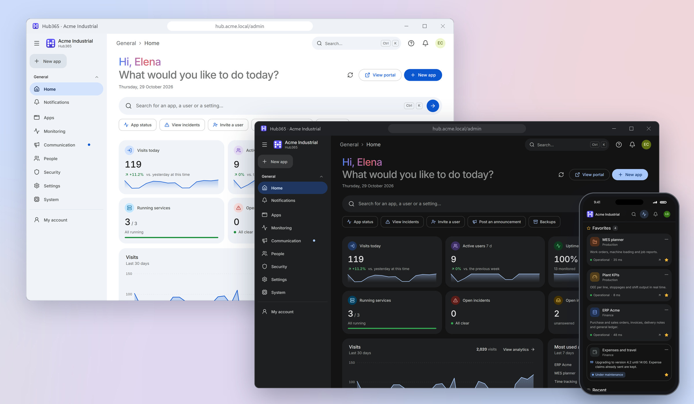
</picture>

</div>

<br>

**Hub365** gathers all of a company's apps in a single portal, reachable from any computer on the
local network. It installs on a Windows server, **works without Internet access** and is managed
entirely from the browser: branding, apps, users, permissions, monitoring and backups, with no code.

It publishes three kinds of apps:

| Type | What it is |
|------|------------|
| 🔗&nbsp;**Link** | A URL to another website on the network or the Internet. |
| 🗂️&nbsp;**Static&nbsp;site** | A website made of files (HTML, CSS, JS) uploaded as a ZIP from the panel, with versions and rollback. |
| ⚙️&nbsp;**Service** | A process (Python, Node, .NET, Streamlit, Grafana, a `.bat`, an `.exe`…) that Hub365 **starts, watches, restarts and publishes**. |

> [!NOTE]
> This repository only holds the **installers**, the **user manual** and the **release notes**. The
> source code is not published here.

### 📘 User manual

All of Hub365 step by step, with real screenshots: installation and licensing, the admin console and
the employee portal, apps, services and deployments, monitoring and alerts, users, security,
settings, backups, the API, troubleshooting, FAQ and a glossary. Since 2.0.2 it also ships inside
Hub365 (the admin console's **?** button › *User guide (PDF)*).

- 📄 [Manual in English (PDF)](https://github.com/Rannden-SHA/HUB365-Releases/releases/latest/download/Hub365-Manual-en.pdf)
- 📄 [Manual en español (PDF)](https://github.com/Rannden-SHA/HUB365-Releases/releases/latest/download/Hub365-Manual-es.pdf)

## 🧩 Highlights

#### 🎨 Design and language
- Modern Material-style design, in **light and dark** themes
- Sidebar that collapses to icons, and `Ctrl K` search
- Full **English and Spanish** interface, with a per-user selector
- Font and icons bundled: works without Internet

#### 🧑‍💼 Employee portal
- Favorites, recents and "My links"
- Tabbed workspace to keep several apps open
- "Report a problem" and "Request an app"
- PWA (over trusted HTTPS) and kiosk mode for screens

#### ⚙️ Services and deployments
- Autostart, restart on failure and time-based scheduler
- Live logs, CPU and RAM metrics
- Reverse proxy with WebSockets, or optional per-service port for origin isolation
- Static sites from a ZIP, with versions and rollback

#### 📈 Monitoring and alerts
- Checks for **every** app: uptime and latency
- Automatic incidents and a public status page (`/status`)
- Alerts via email, Teams, Slack, Discord, Telegram or webhook

#### 📣 Communication and analytics
- Scheduled announcements and an inbox for problem reports, ideas and requests
- In-app notifications, in real time
- Usage analytics per app, user and hour

#### 🔐 Security
- Administrator, editor and viewer roles; departments; LDAP / Active Directory
- Two-step verification (TOTP) and lockout after failed attempts
- Revocable sessions, audit log and an integration API with scoped tokens
- Restricted data folder and firewall limited to the local subnet

#### 🛠️ System
- Guided first run
- ZIP backups, manual or scheduled, with restore
- HTTPS from the panel and new version notices

## 🖼️ Screenshots

<picture>
  <source media="(prefers-color-scheme: dark)" srcset="docs/img/en-dashboard-dark.png">
  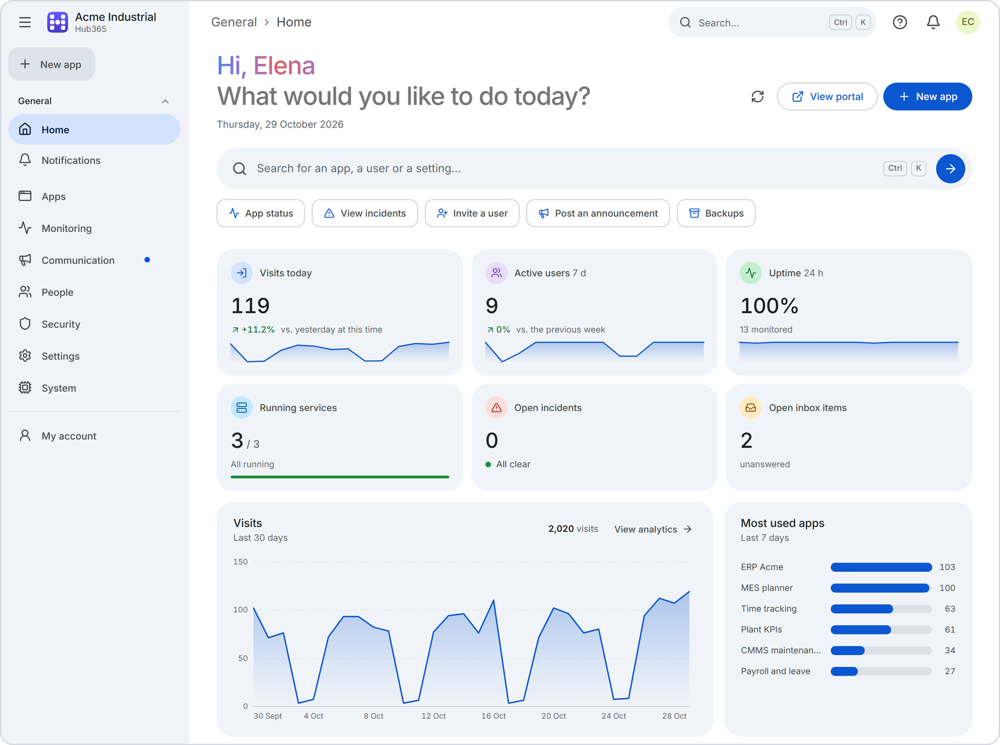
</picture>
<p align="center"><sub><b>Admin panel</b>: visits, uptime, services, incidents and inbox at a glance</sub></p>

<picture>
  <source media="(prefers-color-scheme: dark)" srcset="docs/img/en-portal-dark.png">
  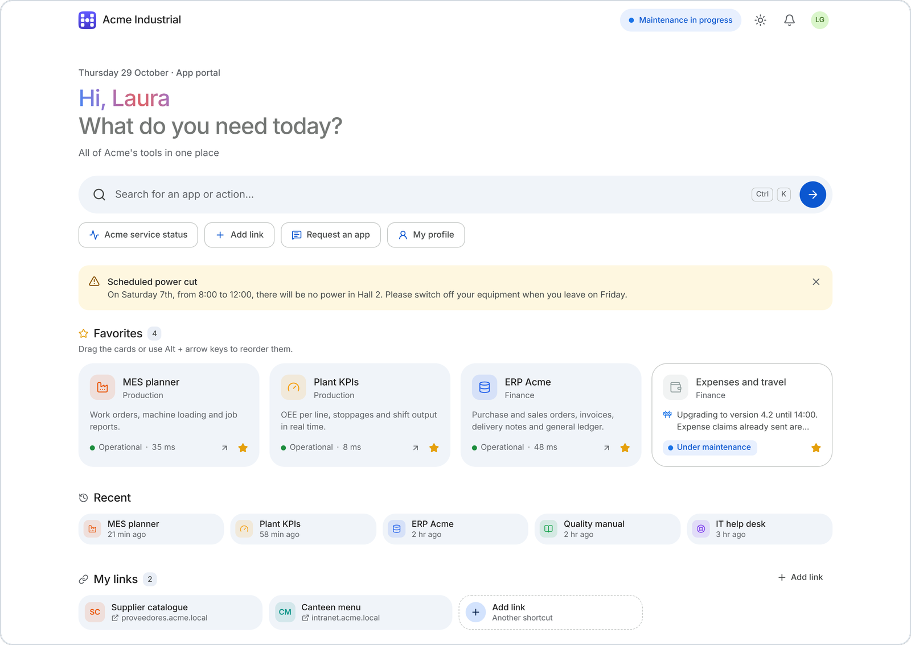
</picture>
<p align="center"><sub><b>Employee portal</b>: announcements, favorites, recents and "My links"</sub></p>

<picture>
  <source media="(prefers-color-scheme: dark)" srcset="docs/img/en-services-dark.png">
  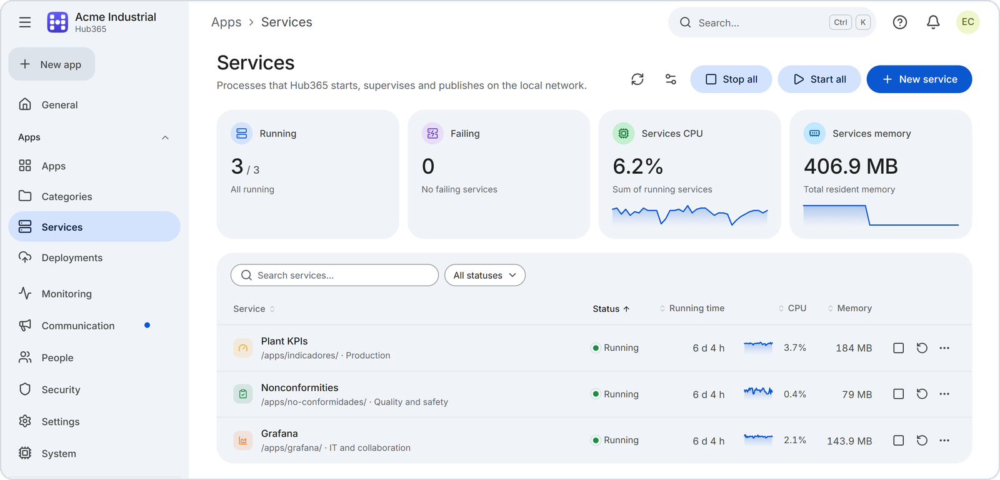
</picture>
<p align="center"><sub><b>Services</b>: processes Hub365 starts and watches, with CPU and memory</sub></p>

<picture>
  <source media="(prefers-color-scheme: dark)" srcset="docs/img/en-status-dark.png">
  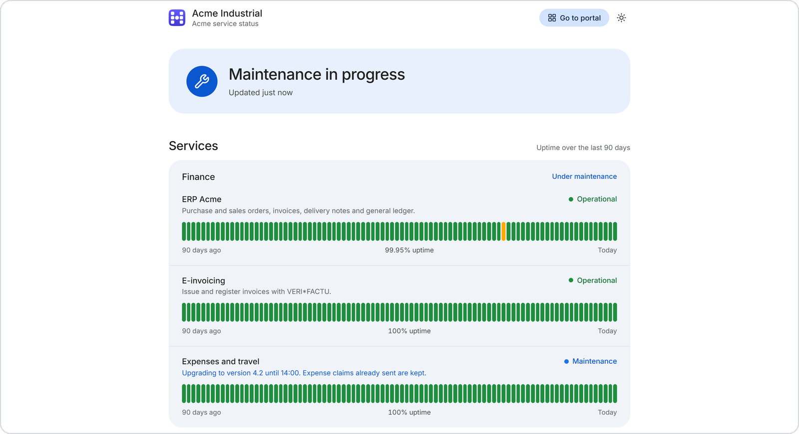
</picture>
<p align="center"><sub><b>Public status page</b> (<code>/status</code>): 90-day uptime and maintenance</sub></p>

<details>
<summary><b>More screenshots</b></summary>
<br>

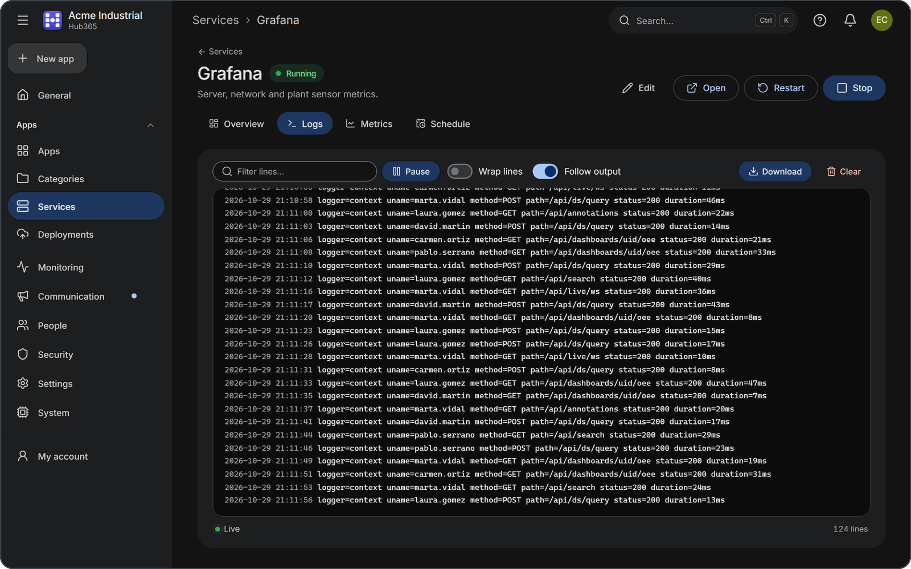
<p align="center"><sub><b>Live logs</b> of a service, with filter and download</sub></p>

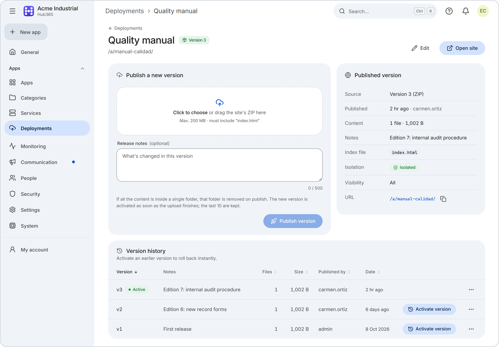
<p align="center"><sub><b>Deployments</b>: active version and history for rollback</sub></p>

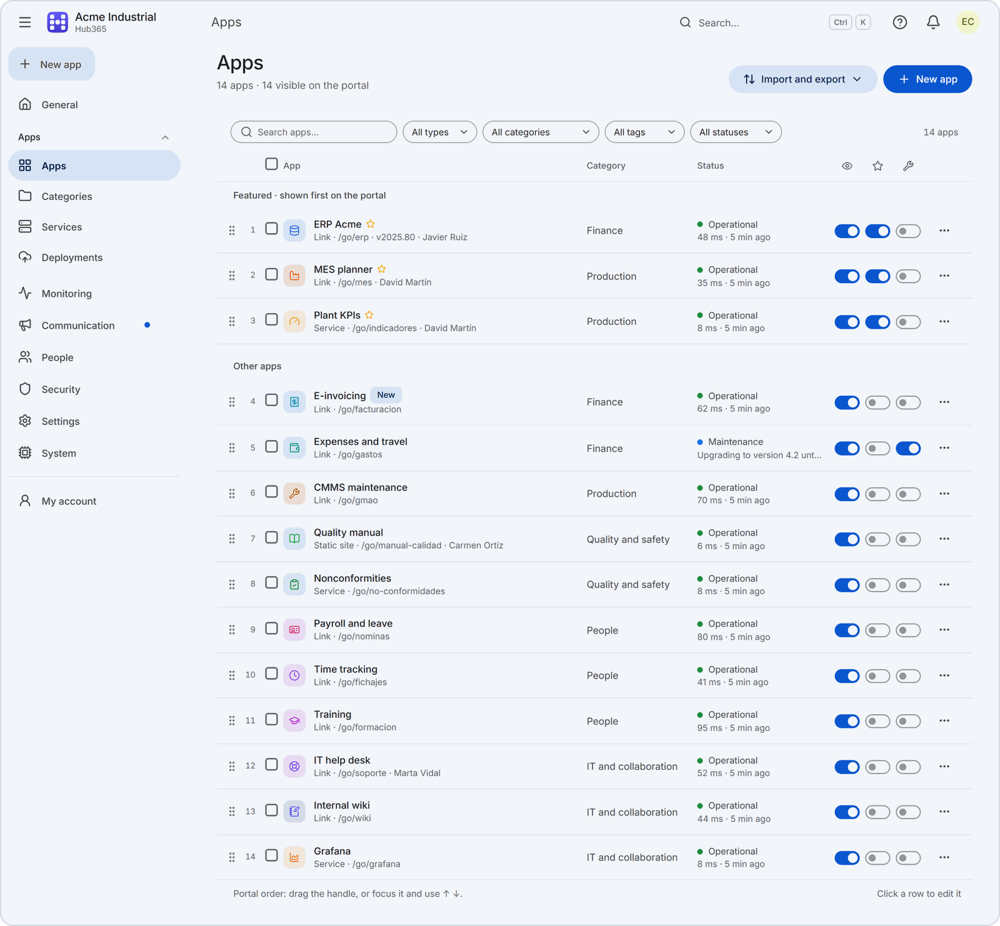
<p align="center"><sub><b>App catalog</b> with status and latency</sub></p>

<p align="center">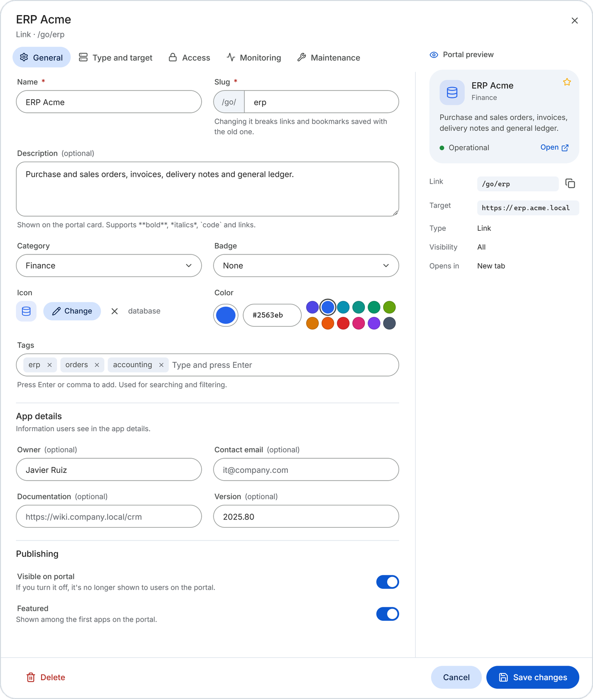</p>
<p align="center"><sub><b>App editor</b> with a preview of the portal card</sub></p>

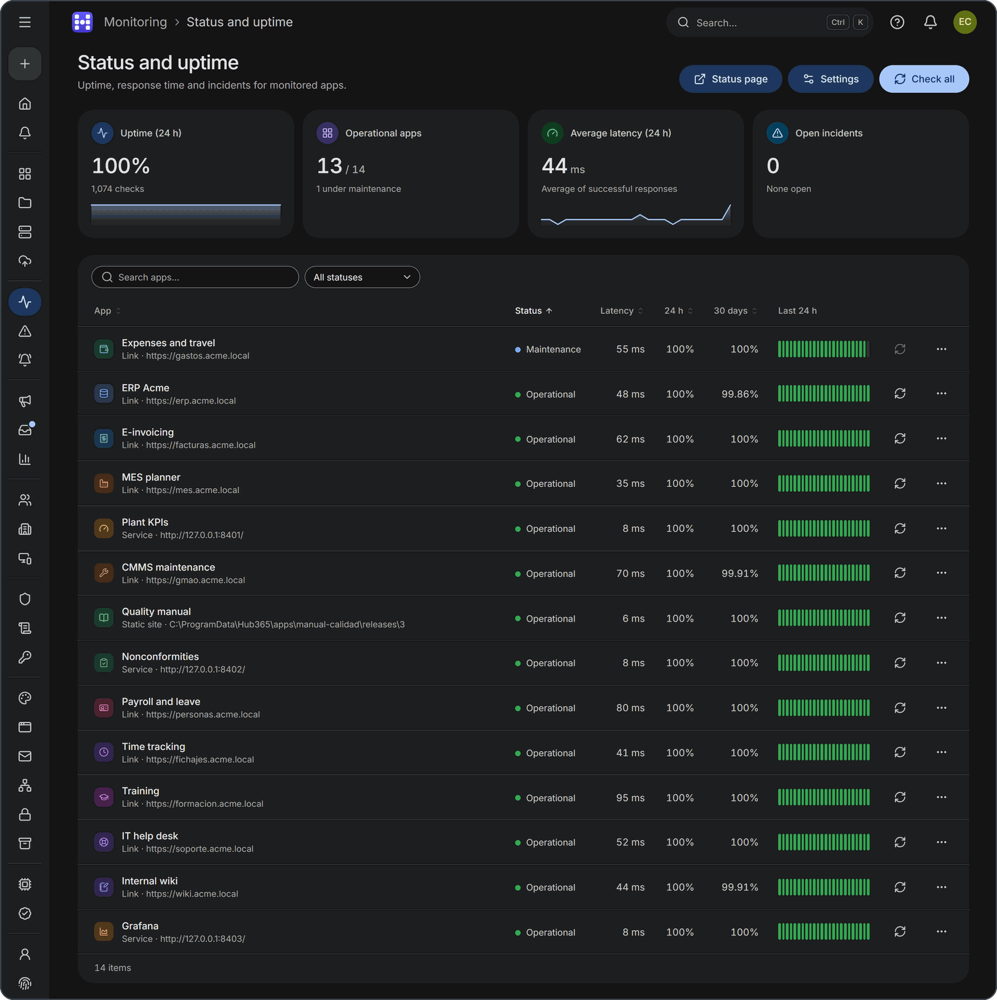
<p align="center"><sub><b>Status and uptime</b> · sidebar collapsed to icons</sub></p>

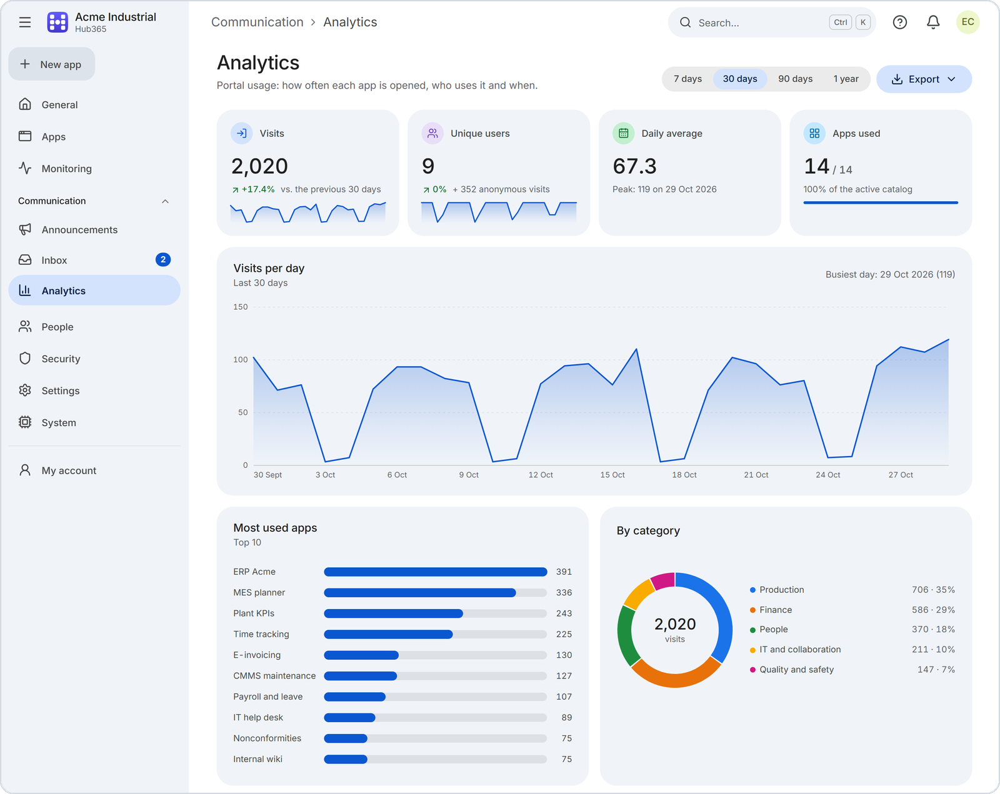
<p align="center"><sub><b>Analytics</b> of visits</sub></p>

<p align="center">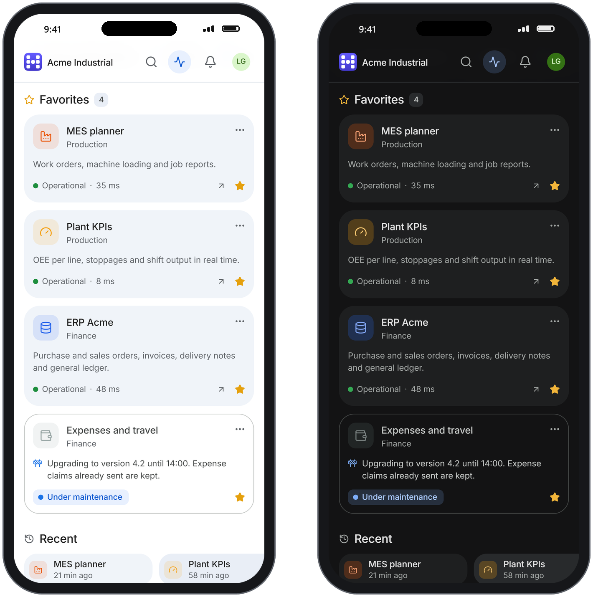</p>
<p align="center"><sub><b>On mobile</b> · light and dark themes</sub></p>

</details>

<sub>Screenshots use demo data from a fictional company. App names are company data and are shown as
entered.</sub>

## 📋 Requirements

| Requirement | Details |
|---|---|
| **Operating system** | Windows 10 / 11 or the equivalent Windows Server, **64-bit** |
| **Permissions** | An **administrator** account to install and start Hub365 |
| **License** | A **per-server activation license** from NextCode Agency (see *License*, at the end) |
| **Python** | **Not needed**: the installer bundles an embedded Python 3.12 with every dependency |
| **Network** | A free TCP port for the portal (**8080** by default); the 8400-8499 range if you publish services on their own port |
| **Browsers** | Any current browser (Edge, Chrome, Firefox, Safari) |
| **Internet** | Optional: only to check for new versions, send alerts to external services or show the weather widget |

## 🚀 Install in 4 steps

1. **Download** `Hub365-Setup-<version>.exe` from *Assets* in the
   [latest release](https://github.com/Rannden-SHA/HUB365-Releases/releases/latest).
2. **Run it** on the server as administrator. The wizard (Spanish and English) shows the license and
   lets you choose the start-up mode (Windows service with NSSM, bundled), access from the local
   network, the company name, the port and optional HTTPS. On a fresh install it also creates your
   **administrator account**: user name (`admin` by default), name and a password of at least 8
   characters. Once the files are copied it asks for
   the **license**: save the activation request, send it to info@nextcodeagency.com and activate the
   `.h365lic` file you receive (or do it later from the panel; until then Hub365 is locked).
3. **Open** `http(s)://SERVER-IP:<port>/admin` (`http` and port 8080 by default) or use the
   *Admin panel* shortcut in the Start menu.
4. **Sign in** with the administrator account you created in the installer and a wizard will guide
   you (company, portal and first apps).

Then turn on two-step verification from *My account*.

The interface starts in Spanish. Picking *English* on the sign-in page only changes the language of
that browser. To make English the default for everyone (including emails and alerts), set the default
language in *Settings › Portal*; each user can also choose it in *My account*.

<details>
<summary><b>Unattended install</b></summary>

```bat
Hub365-Setup-<version>.exe /VERYSILENT /SUPPRESSMSGBOXES /PORT=8080 /LOG="setup.log" /LICENSE="C:\path\license.h365lic" ^
  /ADMINUSER=it-admin /ADMINPASSFILE="C:\path\password.txt"
```

`/ADMINUSER=` and `/ADMINPASSFILE=` (a UTF-8 file with the password on its first line, trailing
spaces removed; UTF-16 or ANSI are rejected, in PowerShell use
`Set-Content -Path C:\Temp\hub365-admin.txt -Value 'MyPassword' -Encoding utf8 -NoNewline`; the password
is not accepted on the command line and is never written to the log) create the administrator
account. Without them, a fresh unattended install creates `admin` / `admin` and asks for a password
change at sign-in.

In unattended mode the branding keeps the default name and HTTPS stays off: change them later from the
panel. `/LICENSE=` activates the license and `/SAVEREQUEST="C:\path"` saves the activation request;
the result goes to the log and setup never stops because of the license.
</details>

## ⬆️ Upgrading from 1.x

> [!IMPORTANT]
> **Before upgrading, copy the `C:\ProgramData\Hub365` folder**: the installer does not take a
> backup. 1.x panel backups only contain the configuration (no users or database); from 2.0 on, a
> full backup from the panel also works.

- Run the new installer **over** the existing installation; there is no need to uninstall. It keeps
  the port, HTTPS and start-up mode, and migrates users (with their passwords), apps, categories,
  announcements, audit log and tokens.
- 1.x does not check for new versions, so it will not tell you about 2.0. Download the installer by
  hand.
- Everyone will need to sign in again; if `admin` still uses `admin`, a password change is required.
- API tokens keep working, but their value can no longer be shown.
- The new `Hub365` and `Hub365-Apps` firewall rules **only admit the server's own subnet**. If users
  are on other VLANs, subnets or on the VPN, widen them (see [FAQ](#-faq)).
- Only the v1 rule for the current port is deleted. If you changed the port in v1 after installing,
  look for leftover rules with `netsh advfirewall firewall show rule name=all | findstr Hub365` and
  delete the `Hub365 <old port>` one: it was open to any IP.

Full notes for each version are on its
[Releases](https://github.com/Rannden-SHA/HUB365-Releases/releases) page.

## 🔄 How updates work

- **Once a day** Hub365 checks the latest release published in this repository (the server needs
  access to `api.github.com`) and notifies administrators in *System and updates*. The check can be
  turned off.
- **It does not update itself**: download the new installer and run it over the installation. It keeps
  the database, apps, users and configuration.
- Without Internet, the panel says it could not check; the rest of Hub365 works as usual.

## 🛡️ Verify your download

Each release lists the installer's **SHA-256** checksum in its notes. Compare it with the file you
downloaded (PowerShell):

```powershell
Get-FileHash .\Hub365-Setup-<version>.exe -Algorithm SHA256
```

If they do not match, do not run the installer and download it again.

## ⚠️ Known limitations

The main ones: with services published on their own port, **JavaScript-readable** cookies are shared
by all services on the same server (browsers do not separate cookies by port); changes to the port,
listen address and HTTPS require restarting Hub365; and only Windows x64 is supported. The full list is
in the [release notes](https://github.com/Rannden-SHA/HUB365-Releases/releases).

## ❓ FAQ

<details>
<summary><b>The portal does not open from other computers</b></summary>

The `Hub365` and `Hub365-Apps` firewall rules only admit computers on the server's own subnet. For
other VLANs, subnets or the VPN, widen them in an administrator console:

```bat
netsh advfirewall firewall set rule name="Hub365" new remoteip=localsubnet,10.0.0.0/8
netsh advfirewall firewall set rule name="Hub365-Apps" new remoteip=localsubnet,10.0.0.0/8
```

Reinstalling or upgrading resets the rules to the local subnet only: run these commands again
afterwards.
</details>

<details>
<summary><b>Can I publish Hub365 on the Internet?</b></summary>

Hub365 is designed for the local network. If you expose it to the Internet, put it behind a reverse
proxy with HTTPS.
</details>

<details>
<summary><b>I changed the port or enabled HTTPS and nothing happened</b></summary>

Changes to the port, listen address and HTTPS require **restarting Hub365** (with the Windows service,
*Network and HTTPS* offers *Restart now*). The `Hub365` firewall rule and the shortcuts are not
updated either: run the installer again or use the `netsh` commands the panel shows.
</details>

<details>
<summary><b>The browser warns that the certificate is not secure</b></summary>

That is the **self-signed** certificate Hub365 generates. You can replace it with your own (for
example, one from your company CA) in *Settings › Network and HTTPS*.
</details>

<details>
<summary><b>The option to install the portal as an app (PWA) does not show up</b></summary>

The PWA needs HTTPS with a certificate the browsers trust. Over HTTP, or with the self-signed
certificate not marked as trusted, the option does not appear.
</details>

<details>
<summary><b>Where are the data and the logs?</b></summary>

The app installs to `C:\Program Files\Hub365` and the data (database, configuration, backups and logs)
lives in `C:\ProgramData\Hub365`, accessible only to Administrators and SYSTEM. The main log is
`logs\hub365.log`, which you can also view and download from *System*. Backups do not include `certs\`
or the logs. The full changelog (`CHANGELOG.md`) is in the installation folder.
</details>

<details>
<summary><b>How to uninstall</b></summary>

*Uninstall Hub365* (Start menu or Windows Settings) stops Hub365, removes the service, the scheduled
task and the firewall rules, and **asks whether to delete the data as well**. A silent uninstall keeps
the data unless you add `/DELETEDATA` (default installation folder shown):

```bat
"C:\Program Files\Hub365\unins000.exe" /VERYSILENT /SUPPRESSMSGBOXES /DELETEDATA
```
</details>

## 📄 License

Proprietary software. The license agreement is shown and accepted during installation.

Hub365 also needs an **activation license for each server**, issued by NextCode Agency: a signed
`.h365lic` file bound to the server fingerprint and checked locally (no Internet).

| Plan | Term | Modules | Apps | Users |
|---|---|---|---|---|
| **Trial** | 30 days | All | Unlimited | Unlimited |
| **Starter** | 1 year | Deployments | 15 | 25 |
| **Pro** | 1 year or perpetual | All except the REST API | 100 | 250 |
| **Enterprise** | 1 year or perpetual | All | Unlimited | Unlimited |

The modules are managed services, deployments, monitoring, analytics, LDAP / Active Directory and
the REST API; the portal itself is in every plan. Without a valid license (not activated, from
another server or expired) Hub365 is locked until one is activated, with no data loss. The panel
(*License*) shows the status and expiry, warns 30, 7 and 1 days before and prepares the renewal
request.

**Licenses** (request, renew, upgrade or move to another server): email
[info@nextcodeagency.com](mailto:info@nextcodeagency.com) and attach the activation request generated by the installer or
the panel.

<p align="right"><a href="#hub365">↑ Back to top</a></p>
