<div align="center">


# Hub365

**Portal de aplicaciones autoalojado para la red local de tu empresa**

[](https://github.com/Rannden-SHA/HUB365-Releases/releases/latest) [](https://github.com/Rannden-SHA/HUB365-Releases/releases) [](#-requisitos) [](README.en.md)

<a href="https://github.com/Rannden-SHA/HUB365-Releases/releases/latest"></a>

**Español** · [English](README.en.md)

<br>

<picture>
  <source media="(prefers-color-scheme: dark)" srcset="docs/img/hero-dark.jpg">
  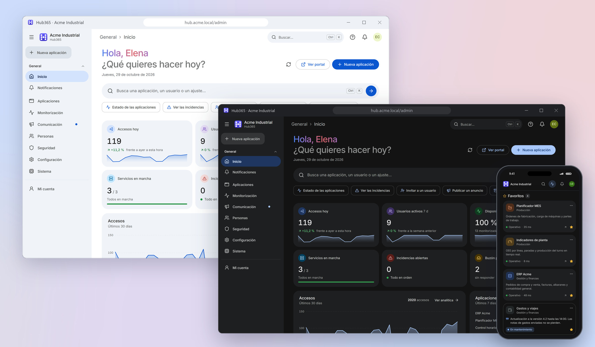
</picture>

</div>

<br>

**Hub365** reúne todas las aplicaciones de una empresa en un único portal, accesible desde cualquier
equipo de la red local. Se instala en un servidor Windows, **funciona sin conexión a Internet** y se
administra entero desde el navegador: marca, aplicaciones, usuarios, permisos, monitorización y
copias de seguridad, sin tocar código.

Publica tres tipos de aplicaciones:

| Tipo | Qué es |
|------|--------|
| 🔗&nbsp;**Enlace** | Una URL a otra web de la red o de Internet. |
| 🗂️&nbsp;**Sitio&nbsp;estático** | Una web de ficheros (HTML, CSS, JS) subida como ZIP desde el panel, con versiones y vuelta atrás. |
| ⚙️&nbsp;**Servicio** | Un proceso (Python, Node, .NET, Streamlit, Grafana, un `.bat`, un `.exe`…) que Hub365 **arranca, vigila, reinicia y publica**. |

> [!NOTE]
> Este repositorio solo contiene los **instaladores** y las **notas de cada versión**. El código
> fuente no se publica aquí.

## 🧩 Lo más destacado

#### 🎨 Diseño e idioma
- Diseño moderno tipo Material, en tema **claro y oscuro**
- Menú lateral que se pliega a iconos y búsqueda con `Ctrl K`
- Interfaz completa en **español e inglés**, con selector por usuario
- Fuente e iconos incluidos: funciona sin Internet

#### 🧑‍💼 Portal del empleado
- Favoritos, recientes y «Mis enlaces»
- Espacio de trabajo con varias aplicaciones en pestañas
- «Informar de un problema» y «Solicitar una aplicación»
- PWA (con HTTPS de confianza) y modo kiosco para pantallas

#### ⚙️ Servicios y despliegues
- Arranque automático, reinicio si se caen y programador horario
- Registros en vivo y métricas de CPU y RAM
- Proxy inverso con WebSockets o, si se quiere aislar, publicación en un puerto propio
- Sitios estáticos por ZIP con versiones y vuelta atrás

#### 📈 Monitorización y alertas
- Comprobación de **todas** las aplicaciones: disponibilidad y latencia
- Incidencias automáticas y página pública de estado (`/status`)
- Alertas por correo, Teams, Slack, Discord, Telegram o webhook

#### 📣 Comunicación y analítica
- Anuncios programados y buzón de problemas, sugerencias y solicitudes
- Notificaciones dentro de la aplicación, en tiempo real
- Analítica de uso por aplicación, usuario y hora

#### 🔐 Seguridad
- Roles de administrador, editor y visor; departamentos; LDAP / Active Directory
- Verificación en dos pasos (TOTP) y bloqueo por intentos
- Sesiones revocables, auditoría y API para integraciones con tokens por ámbitos
- Carpeta de datos restringida y firewall limitado a la subred local

#### 🛠️ Sistema
- Primer arranque guiado
- Copias de seguridad en ZIP, manuales o programadas, con restauración
- HTTPS desde el panel y aviso de nuevas versiones

## 🖼️ Capturas

<picture>
  <source media="(prefers-color-scheme: dark)" srcset="docs/img/dashboard-dark.png">
  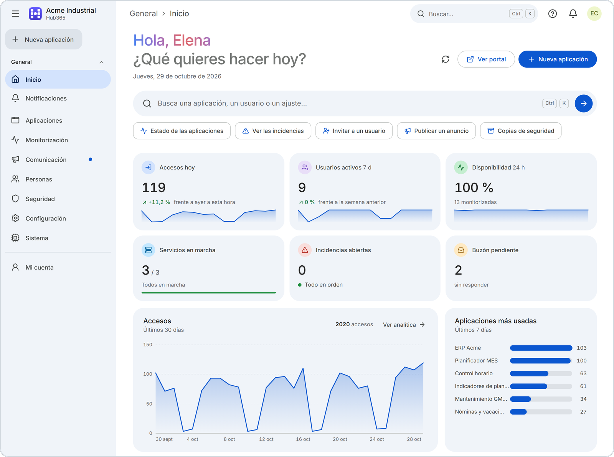
</picture>
<p align="center"><sub><b>Panel de administración</b>: accesos, disponibilidad, servicios, incidencias y buzón de un vistazo</sub></p>

<picture>
  <source media="(prefers-color-scheme: dark)" srcset="docs/img/portal-dark.png">
  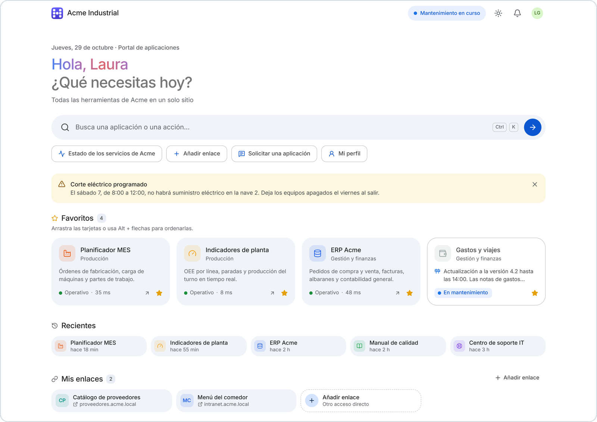
</picture>
<p align="center"><sub><b>Portal del empleado</b>: anuncios, favoritos, recientes y «Mis enlaces»</sub></p>

<picture>
  <source media="(prefers-color-scheme: dark)" srcset="docs/img/services-dark.png">
  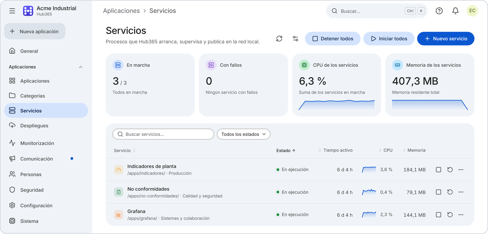
</picture>
<p align="center"><sub><b>Servicios</b>: procesos que Hub365 arranca y vigila, con CPU y memoria</sub></p>

<picture>
  <source media="(prefers-color-scheme: dark)" srcset="docs/img/status-dark.png">
  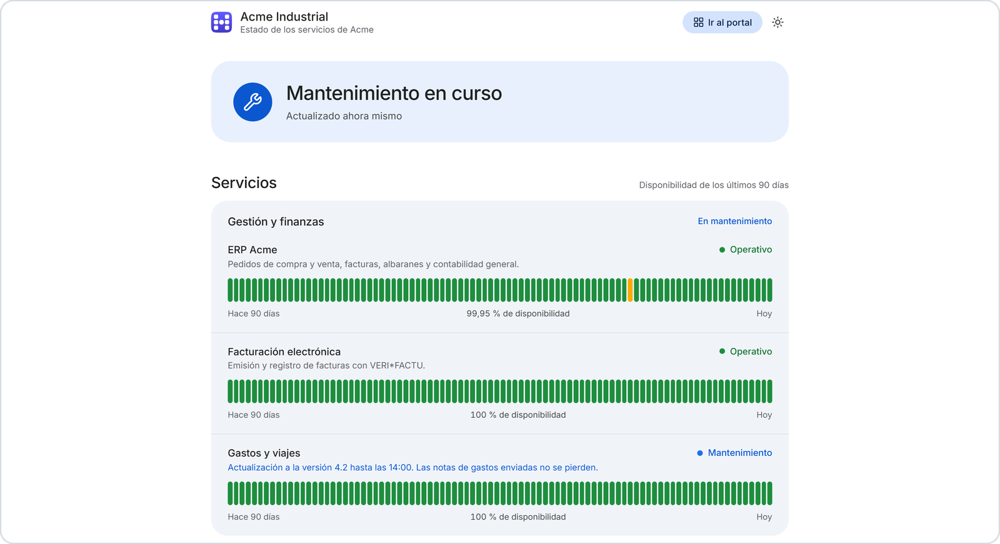
</picture>
<p align="center"><sub><b>Página pública de estado</b> (<code>/status</code>): disponibilidad de 90 días y mantenimientos</sub></p>

<details>
<summary><b>Más capturas</b></summary>
<br>

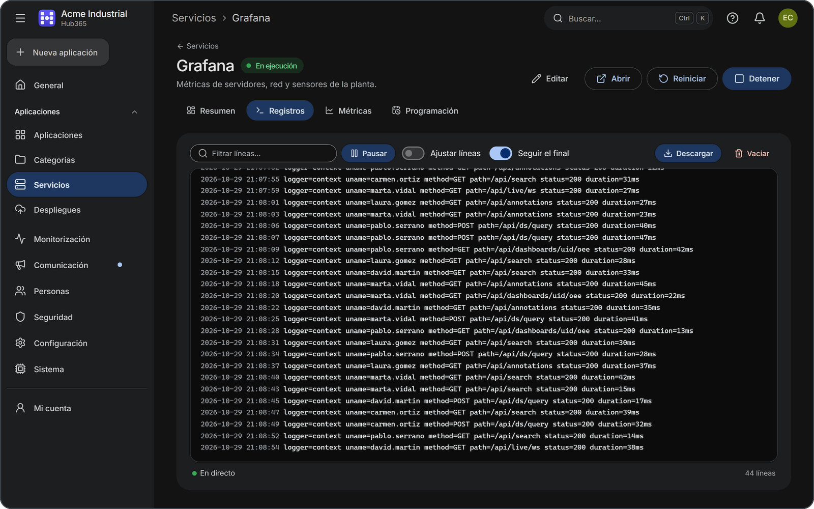
<p align="center"><sub><b>Registros en vivo</b> de un servicio, con filtro y descarga</sub></p>

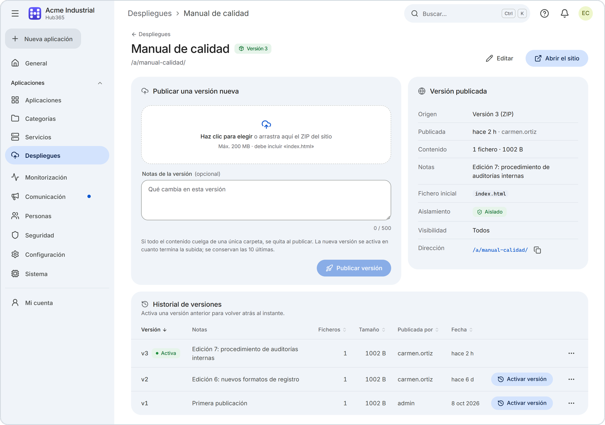
<p align="center"><sub><b>Despliegues</b>: versión activa e historial para volver atrás</sub></p>

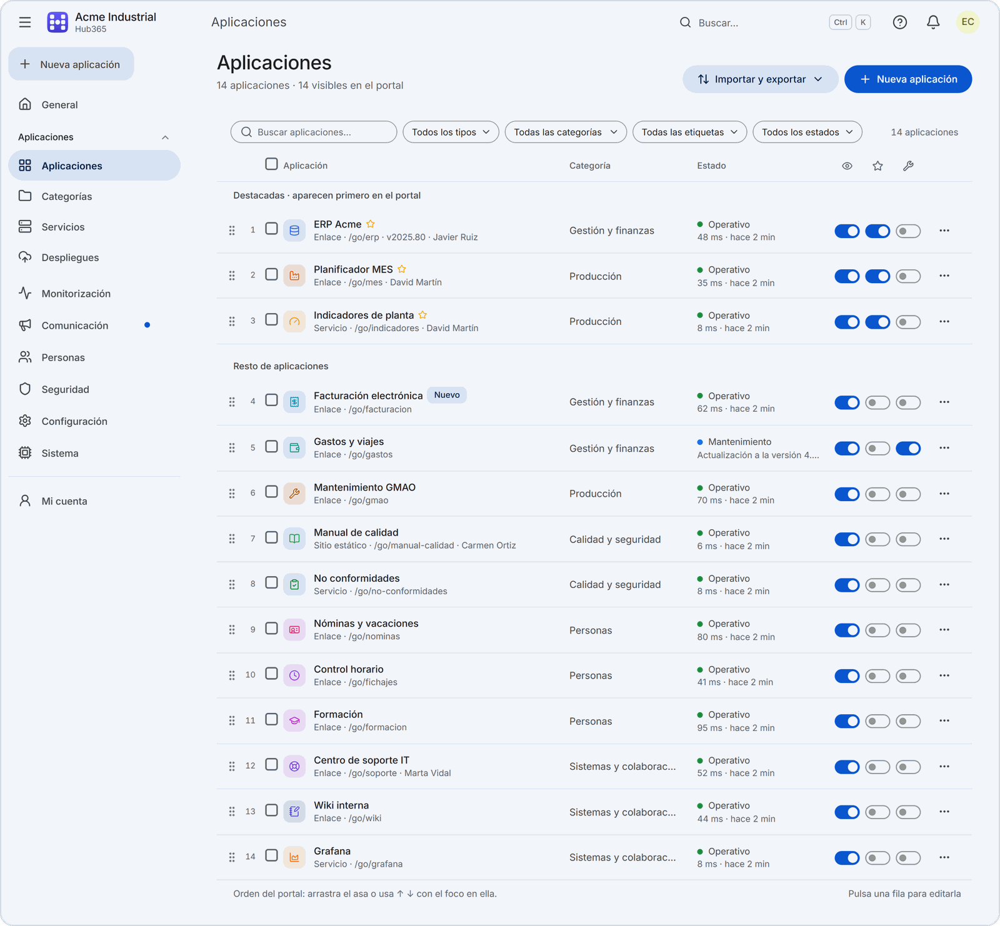
<p align="center"><sub><b>Catálogo de aplicaciones</b> con su estado y latencia</sub></p>

<p align="center">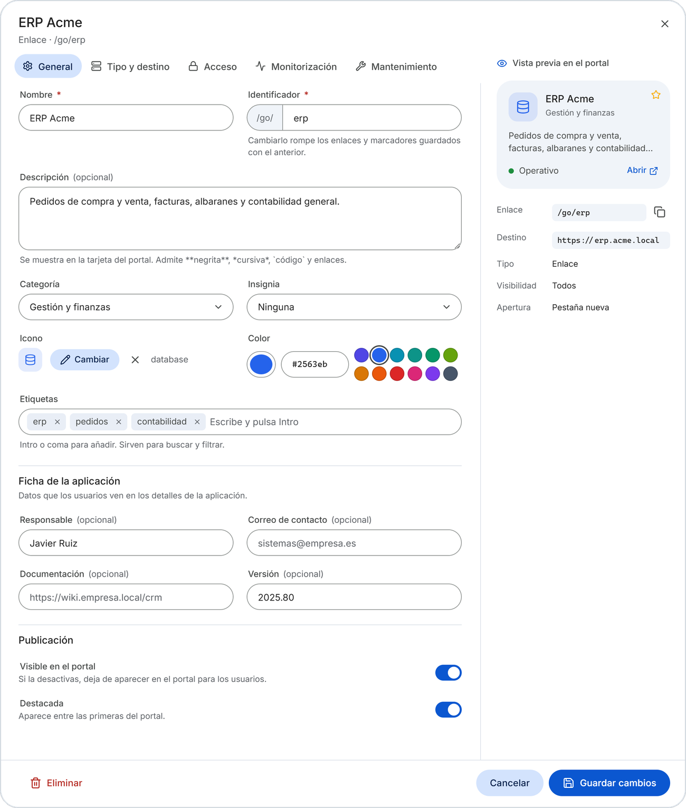</p>
<p align="center"><sub><b>Editor de aplicaciones</b> con vista previa de la tarjeta</sub></p>

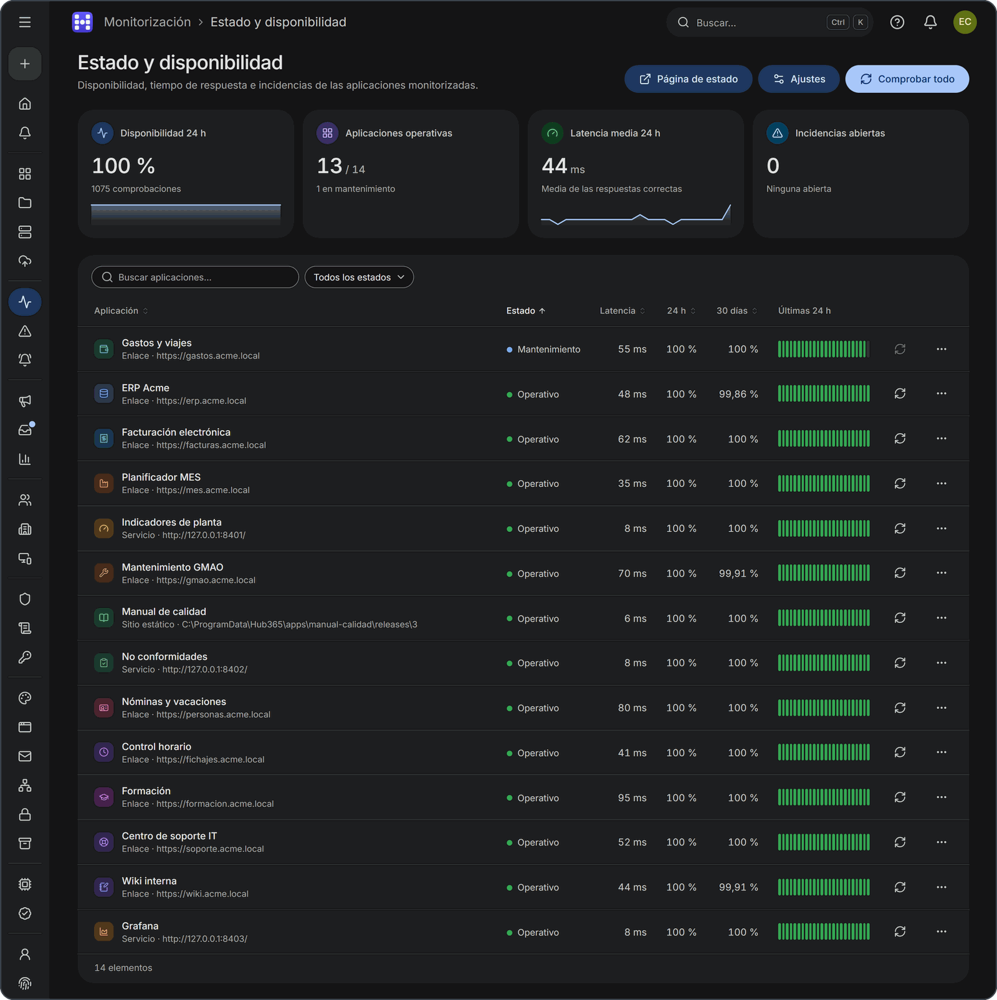
<p align="center"><sub><b>Estado y disponibilidad</b> · menú lateral plegado a iconos</sub></p>

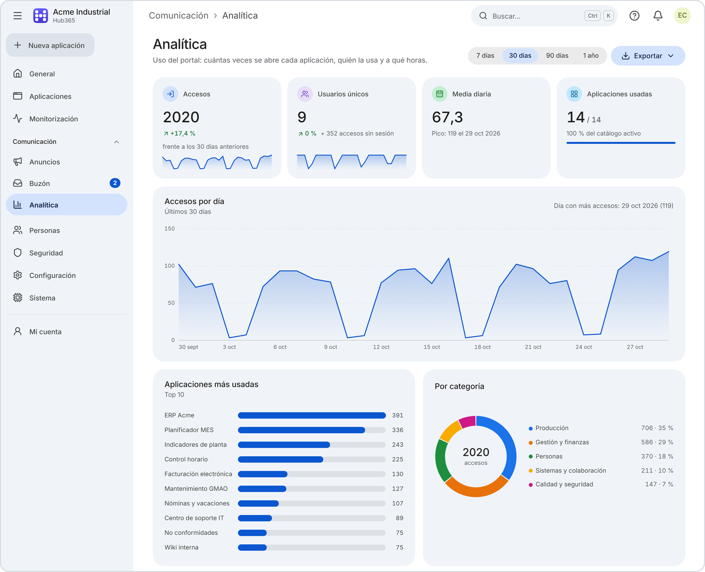
<p align="center"><sub><b>Analítica</b> de accesos</sub></p>

<p align="center">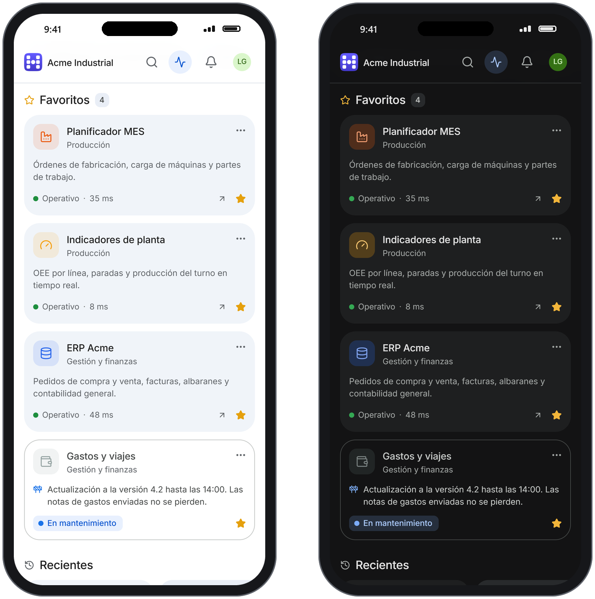</p>
<p align="center"><sub><b>En el móvil</b> · tema claro y oscuro</sub></p>

</details>

<sub>Capturas con datos de demostración de una empresa ficticia. Los nombres de las aplicaciones son
datos de cada empresa y se muestran tal como se escriben.</sub>

## 📋 Requisitos

| Requisito | Detalle |
|---|---|
| **Sistema operativo** | Windows 10 / 11 o Windows Server equivalente, **64 bits** |
| **Permisos** | Una cuenta de **administrador** para instalar e iniciar Hub365 |
| **Licencia** | Una **licencia de activación por servidor** de NextCode Agency (ver *Licencia*, al final) |
| **Python** | **No hace falta**: el instalador incluye un Python 3.12 embebido con todas las dependencias |
| **Red** | Un puerto TCP libre para el portal (**8080** por defecto); el rango 8400-8499 si publicas servicios en su propio puerto |
| **Navegadores** | Cualquier navegador actual (Edge, Chrome, Firefox, Safari) |
| **Internet** | Opcional: solo para comprobar versiones nuevas, enviar alertas a servicios externos o mostrar el widget del tiempo |

## 🚀 Instalación en 4 pasos

1. **Descarga** `Hub365-Setup-<versión>.exe` desde *Assets* en la
   [última versión](https://github.com/Rannden-SHA/HUB365-Releases/releases/latest).
2. **Ejecútalo** en el servidor como administrador. El asistente (en español e inglés) muestra la
   licencia y te deja elegir el arranque automático (servicio de Windows con NSSM, incluido), el
   acceso desde la red local, el nombre de la empresa, el puerto y HTTPS opcional. En una
   instalación nueva crea además tu **cuenta de administrador**: usuario (por defecto `admin`),
   nombre y contraseña de al menos 8 caracteres. Al terminar de
   copiar los archivos pide la **licencia**: guarda la solicitud de activación, envíala a
   info@nextcodeagency.com y activa el fichero `.h365lic` que recibas (o hazlo más tarde desde el
   panel; hasta entonces Hub365 queda bloqueado).
3. **Abre** `http(s)://IP-DEL-SERVIDOR:<puerto>/admin` (`http` y el puerto 8080 por defecto) o usa el
   acceso directo *Panel de administración* del menú Inicio.
4. **Entra** con la cuenta de administrador que creaste en el instalador y un asistente te guiará
   (empresa, portal y primeras aplicaciones).

Después, activa la verificación en dos pasos desde *Mi cuenta*.

La interfaz arranca en español. Elegir *English* en la página de acceso solo cambia el idioma de ese
navegador: para que el inglés sea el idioma de todos (también en correos y alertas), cambia el idioma
por defecto en *Configuración › Portal*. Cada usuario puede elegir además el suyo en *Mi cuenta*.

<details>
<summary><b>Instalación desatendida</b></summary>

```bat
Hub365-Setup-<versión>.exe /VERYSILENT /SUPPRESSMSGBOXES /PORT=8080 /LOG="setup.log" /LICENSE="C:\ruta\licencia.h365lic" ^
  /ADMINUSER=it-admin /ADMINPASSFILE="C:\ruta\contraseña.txt"
```

`/ADMINUSER=` y `/ADMINPASSFILE=` (fichero UTF-8 con la contraseña en la primera línea, sin los
espacios del final; UTF-16 o ANSI se rechazan, en PowerShell usa
`Set-Content -Path C:\Temp\hub365-admin.txt -Value 'MiContraseña' -Encoding utf8 -NoNewline`; la
contraseña no se admite en la línea de comandos ni se escribe en el registro) crean la cuenta de
administrador. Sin ellos, una instalación desatendida nueva crea `admin` / `admin` y pide cambiar la
contraseña al entrar.

En modo desatendido la marca queda con el nombre por defecto y HTTPS desactivado: cámbialos después
desde el panel. `/LICENSE=` activa la licencia y `/SAVEREQUEST="C:\ruta"` guarda la solicitud de
activación; el resultado queda en el registro y la instalación nunca se detiene por la licencia.
</details>

## ⬆️ Actualizar desde la 1.x

> [!IMPORTANT]
> **Antes de actualizar, copia la carpeta `C:\ProgramData\Hub365`**: el instalador no hace copia de
> seguridad. Las copias del panel de la 1.x solo contienen la configuración (sin usuarios ni base de
> datos); desde la 2.0 también sirve una copia completa hecha desde el panel.

- Ejecuta el instalador nuevo **encima** de la instalación existente; no hace falta desinstalar.
  Conserva puerto, HTTPS y modo de arranque, y migra usuarios (con sus contraseñas), aplicaciones,
  categorías, anuncios, auditoría y tokens.
- La 1.x no comprueba si hay versiones nuevas: no avisará de la 2.0. Descarga el instalador a mano.
- Todos los usuarios deberán volver a iniciar sesión; si `admin` sigue con `admin`, se le pedirá
  cambiar la contraseña.
- Los tokens de API siguen funcionando, pero su valor ya no se puede volver a ver.
- Las nuevas reglas de firewall `Hub365` y `Hub365-Apps` **solo admiten la misma subred** que el
  servidor. Si hay usuarios en otras VLAN, subredes o en la VPN, amplíalas (ver
  [Preguntas frecuentes](#-preguntas-frecuentes)).
- Solo se borra la regla de la v1 con el puerto actual. Si cambiaste el puerto en la v1 después de
  instalar, busca reglas antiguas con `netsh advfirewall firewall show rule name=all | findstr Hub365`
  y borra la de `Hub365 <puerto antiguo>`: estaba abierta a cualquier IP.

Las notas completas de cada versión están en su página de
[Releases](https://github.com/Rannden-SHA/HUB365-Releases/releases).

## 🔄 Cómo funcionan las actualizaciones

- Hub365 consulta **una vez al día** la última versión publicada en este repositorio (necesita acceso a
  `api.github.com` desde el servidor) y avisa a los administradores en *Sistema y actualizaciones*.
  La comprobación se puede desactivar.
- **No se actualiza solo**: descarga el instalador nuevo y ejecútalo encima de la instalación. Conserva
  la base de datos, las aplicaciones, los usuarios y la configuración.
- Sin Internet, el panel indica que no se pudo comprobar; el resto de Hub365 funciona igual.

## 🛡️ Verificar la descarga

Cada versión indica en sus notas la suma **SHA-256** del instalador. Compárala con la del fichero que
has descargado (PowerShell):

```powershell
Get-FileHash .\Hub365-Setup-<versión>.exe -Algorithm SHA256
```

Si no coinciden, no ejecutes el instalador y vuelve a descargarlo.

## ⚠️ Limitaciones conocidas

Las más importantes: con los servicios publicados en su propio puerto, las cookies **legibles por
JavaScript** se comparten entre todos los servicios del mismo servidor (los navegadores no separan
cookies por puerto); los cambios de puerto, dirección de escucha y HTTPS requieren reiniciar Hub365, y
solo hay versión para Windows x64. La lista completa está en las
[notas de cada versión](https://github.com/Rannden-SHA/HUB365-Releases/releases).

## ❓ Preguntas frecuentes

<details>
<summary><b>Desde otros equipos no se abre el portal</b></summary>

Las reglas de firewall `Hub365` y `Hub365-Apps` solo admiten equipos de la misma subred que el
servidor. Para otras VLAN, subredes o la VPN, amplíalas en una consola como administrador:

```bat
netsh advfirewall firewall set rule name="Hub365" new remoteip=localsubnet,10.0.0.0/8
netsh advfirewall firewall set rule name="Hub365-Apps" new remoteip=localsubnet,10.0.0.0/8
```

Reinstalar o actualizar vuelve a dejar las reglas solo con la subred local: repite estos comandos
después.
</details>

<details>
<summary><b>¿Puedo publicar Hub365 en Internet?</b></summary>

Hub365 está pensado para la red local. Si lo expones a Internet, hazlo detrás de un proxy inverso
con HTTPS.
</details>

<details>
<summary><b>He cambiado el puerto o activado HTTPS y no se aplica</b></summary>

Los cambios de puerto, dirección de escucha y HTTPS requieren **reiniciar Hub365** (con el servicio
de Windows, *Red y HTTPS* ofrece *Reiniciar ahora*). Además, la regla de firewall `Hub365` y los
accesos directos no se actualizan solos: vuelve a ejecutar el instalador o usa los comandos `netsh`
que muestra el panel.
</details>

<details>
<summary><b>El navegador avisa de que el certificado no es seguro</b></summary>

Es el certificado **autofirmado** que genera Hub365. Puedes sustituirlo por uno propio (por ejemplo, de
la CA de la empresa) en *Configuración › Red y HTTPS*.
</details>

<details>
<summary><b>No aparece la opción de instalar el portal como aplicación (PWA)</b></summary>

La PWA requiere HTTPS con un certificado en el que confíen los navegadores. Por HTTP, o con el
autofirmado sin marcar como de confianza, la opción no aparece.
</details>

<details>
<summary><b>¿Dónde están los datos y los registros?</b></summary>

La aplicación se instala en `C:\Program Files\Hub365` y los datos (base de datos, configuración,
copias y registros) en `C:\ProgramData\Hub365`, accesible solo para Administradores y SYSTEM. El
registro principal es `logs\hub365.log`, que también se ve y se descarga desde *Sistema*. Las copias
de seguridad no incluyen `certs\` ni los registros. El registro completo de cambios (`CHANGELOG.md`)
está en la carpeta de instalación.
</details>

<details>
<summary><b>Cómo desinstalar</b></summary>

*Desinstalar Hub365* (menú Inicio o Configuración de Windows) detiene Hub365, quita el servicio, la
tarea programada y las reglas de firewall, y **pregunta si borrar también los datos**. En una
desinstalación silenciosa los datos se conservan, salvo que se añada `/DELETEDATA` (con la carpeta de
instalación por defecto):

```bat
"C:\Program Files\Hub365\unins000.exe" /VERYSILENT /SUPPRESSMSGBOXES /DELETEDATA
```
</details>

## 📄 Licencia

Software propietario. El contrato de licencia se muestra y se acepta durante la instalación.

Hub365 necesita además una **licencia de activación para cada servidor**, emitida por NextCode
Agency: un fichero `.h365lic` firmado y ligado a la huella del servidor, que se comprueba en local
(sin Internet).

| Plan | Duración | Módulos | Aplicaciones | Usuarios |
|---|---|---|---|---|
| **Prueba** | 30 días | Todos | Ilimitadas | Ilimitados |
| **Starter** | 1 año | Despliegues | 15 | 25 |
| **Pro** | 1 año o perpetua | Todos salvo la API REST | 100 | 250 |
| **Enterprise** | 1 año o perpetua | Todos | Ilimitadas | Ilimitados |

Los módulos son servicios gestionados, despliegues, monitorización, analítica, LDAP / Active
Directory y API REST; el portal en sí está en todos los planes. Sin licencia válida (no activada,
de otro servidor o caducada) Hub365 queda bloqueado hasta activarla, sin perder datos. El panel
(*Licencia*) muestra el estado y la caducidad, avisa 30, 7 y 1 días antes y prepara la petición de
renovación.

**Licencias** (pedirlas, renovarlas, ampliarlas o trasladarlas a otro servidor): escribe a
[info@nextcodeagency.com](mailto:info@nextcodeagency.com) adjuntando la solicitud de activación que genera el instalador o el
panel.

<p align="right"><a href="#hub365">↑ Volver arriba</a></p>
